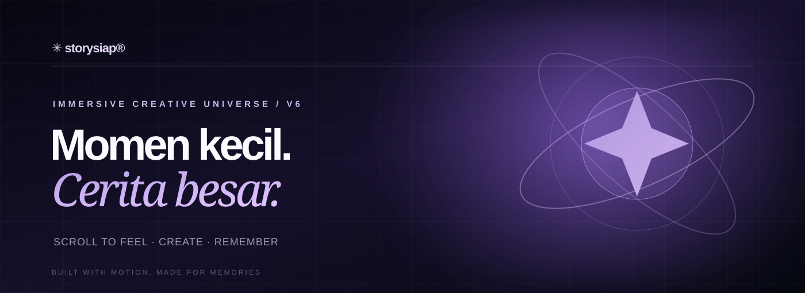
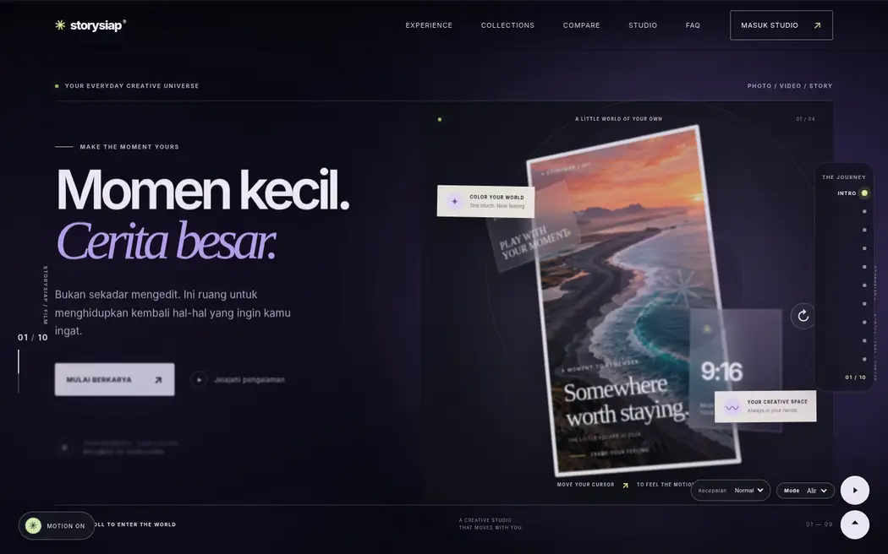
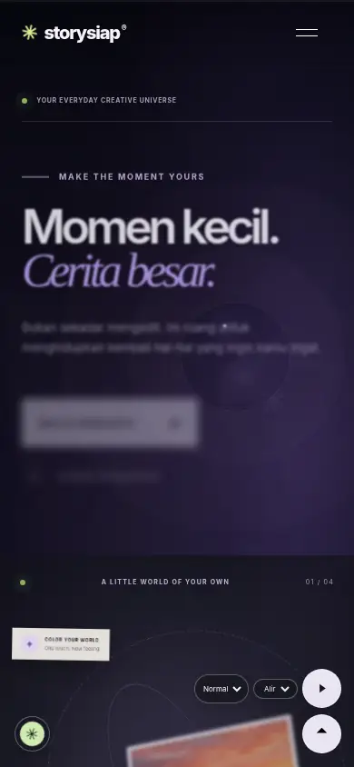
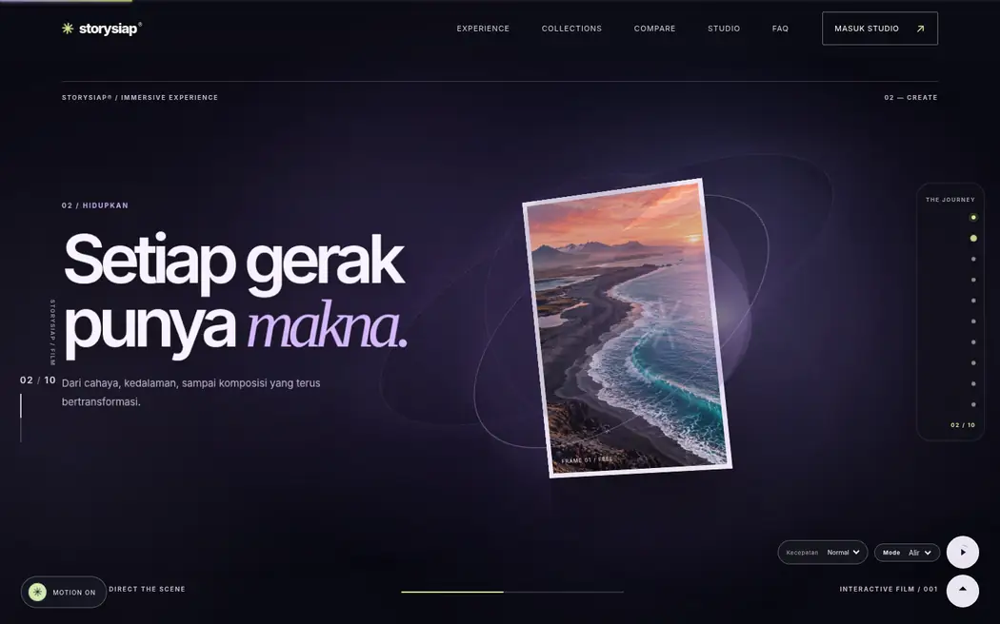
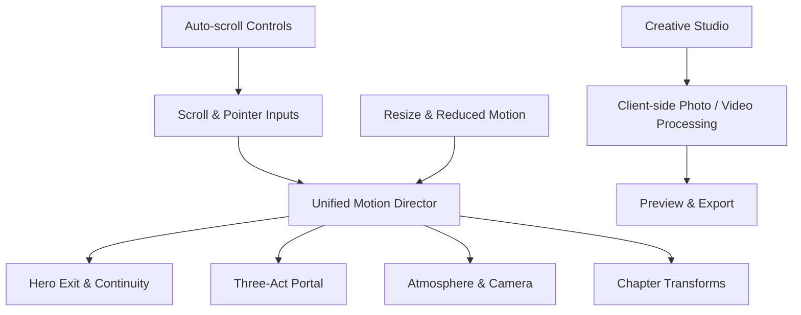

<div align="center">



<br />

### An immersive playground for the stories worth keeping.

**One continuous scroll film · Creative Studio · Motion that responds to you**

<br />

[](https://wawanwfs.github.io/siapstory/)
[](https://wawanwfs.github.io/siapstory/studio.html)
[](https://github.com/wawanwfs/siapstory/actions/workflows/deploy-pages.yml)

<sub>Made for the feeling. Built for the frame. Designed to move with you.</sub>

</div>

---

## ✦ The experience

StorySiap bukan sekadar halaman promosi biasa. Ini adalah **landing page sinematik berbasis scroll** yang menghubungkan pengalaman visual dari satu bab ke bab berikutnya, menuju Creative Studio untuk mengolah foto dan video langsung di browser.

<div align="center">
  
  
</div>

<div align="center"><sub>01 / CINEMATIC HERO — desktop &amp; mobile responsive</sub></div>

<br />

<div align="center">

<br /><sub>02 / SCROLL-DIRECTED MOTION — a visual story that changes with the page</sub>
</div>

## ✳ Designed to be experienced

| EXPERIENCE | WHAT IT FEELS LIKE |
| :--- | :--- |
| **01 · Continuous scroll director** | Satu sumber progres scroll untuk kamera, cahaya, objek 3D, dan perubahan antarbab. |
| **02 · Three-act cinematic portal** | Tiga adegan yang berubah seiring scroll: **Feel → Create → Share**. |
| **03 · Living atmosphere** | Ambient glow, orbit, kartu perspektif, efek kedalaman, dan interaksi pointer. |
| **04 · Auto-scroll with control** | Play/pause pada ikon kanan bawah, mode **Alir / Bab**, dan tiga kecepatan. |
| **05 · Creative Studio** | Framing, template, warna, penyesuaian gambar, teks dan ekspor media. |
| **06 · Premium finishing** | Warmth, film grain, vignette, presets, dan kontrol preview before/after. |
| **07 · Accessible by design** | Reduce Motion, keyboard navigation, responsive layout, serta fallback non-WebGL. |

<details>
<summary><b>Explore the motion architecture</b> — the creative engine under the surface</summary>



Landing UI disimpan dalam `dist/`, dengan skrip animasi terpusat di `dist/cinematic-v6.mjs`, dan interaksi lainnya di `dist/landing.mjs`. Tidak memerlukan framework frontend atau layanan backend.

</details>

## ▰ Launch it locally

**Windows 10/11** — buka `START-WINDOWS.bat`; server mencari port bebas dan membuka browser otomatis. Jangan tutup jendela CMD selama melakukan review.

**macOS / Linux**

```bash
python3 -m http.server 8000 --directory dist
# Open http://localhost:8000/
```

**Test**

```bash
node --test tests/*.test.mjs
```

## ◇ Pages deployment

Perubahan yang di-*push* ke **`main`** otomatis memicu `.github/workflows/deploy-pages.yml` untuk menerbitkan folder `dist/` ke GitHub Pages.

| | |
| :--- | :--- |
| **Website** | https://wawanwfs.github.io/siapstory/ |
| **Studio** | https://wawanwfs.github.io/siapstory/studio.html |
| **Actions** | https://github.com/wawanwfs/siapstory/actions |
| **Deploy source** | `dist/` |

Jika Pages belum diaktifkan: **Settings → Pages → Build and deployment → Source: GitHub Actions**. Setelah workflow sukses, link di atas bisa direview setiap kali ada commit terbaru.

## ⟡ Project map

```text
siapstory/
├── dist/                     # Deployable website, no build required
│   ├── index.html            # Immersive landing
│   ├── studio.html           # Creative workspace
│   ├── cinematic-v6.mjs      # One scroll director
│   ├── landing.mjs           # Interaction engine & auto-scroll
│   ├── app.mjs               # Studio controller
│   └── assets/               # Visuals and textures
├── docs/                     # Branded README visuals
├── tests/                    # Node.js tests
├── launcher/                 # Windows server helpers
├── START-WINDOWS.bat
└── .github/workflows/         # Automated GitHub Pages deploy
```

## ✽ Engineering notes

- **Privacy:** processing foto/video dilakukan secara lokal oleh browser. Media tidak diunggah ke server StorySiap.
- **Video:** ekspor MP4 bergantung pada dukungan codec di browser/perangkat; hasil tidak dijamin kompatibel dengan semua perangkat.
- **Performance:** WebGL dan efek berat memiliki fallback; gunakan Motion OFF atau preferensi sistem Reduce Motion bila perlu.
- **Responsive:** nyaman di desktop dan mobile; efek pointer disesuaikan untuk input sentuh.
- **Assets:** contoh visual berasal dari aset proyek dan digunakan untuk demo. Lihat `ASSETS.md`.

---

<div align="center">

### Every moment has a story.

**Keep the moment. Create the feeling.**

<sub>StorySiap® · Immersive Cinematic Experience · © 2026</sub>

</div>
